# Creative Coding Lab: Developer Architecture and Reference

| Field | Value |
|---|---|
| Audience | Lab maintainers, Template maintainers, and experiment developers |
| Source | Design document v0.8 |
| Status | Intended architecture for implementation |
| Companion | [Coding Standards](../Docs/coding-standards.md) |

Use this reference to locate responsibilities, understand decisions, and plan changes. Diagrams describe the intended system. File layouts and API examples are illustrative. Open choices are collected in the decision register.

The [source design](../Docs/Archive/creative-coding-lab-design-v0.8.md) remains the authority for design intent. Source links accompany each topic. Implementation evidence can be added as the system develops.

## Contents

- [Creative Coding Lab: Developer Architecture and Reference](#creative-coding-lab-developer-architecture-and-reference)
  - [Contents](#contents)
  - [1. System context](#1-system-context)
    - [Reasoning](#reasoning)
  - [2. Repositories and source structure](#2-repositories-and-source-structure)
    - [Experiment layout](#experiment-layout)
    - [Indicative Lab layout](#indicative-lab-layout)
    - [Reasoning](#reasoning-1)
  - [3. Technology choices](#3-technology-choices)
    - [Reasoning](#reasoning-2)
  - [4. Runtime boundaries](#4-runtime-boundaries)
    - [Reasoning](#reasoning-3)
  - [5. Lifecycle and scheduling](#5-lifecycle-and-scheduling)
    - [Established lifecycle subset](#established-lifecycle-subset)
    - [Timing sequence](#timing-sequence)
    - [Caught errors](#caught-errors)
    - [Reasoning](#reasoning-4)
  - [6. Entities, spatial queries, and contact](#6-entities-spatial-queries-and-contact)
    - [Query and contact contracts](#query-and-contact-contracts)
    - [Reasoning](#reasoning-5)
  - [7. Rendering, camera, and audio](#7-rendering-camera-and-audio)
  - [8. Controls and input](#8-controls-and-input)
    - [Reasoning](#reasoning-6)
  - [9. Run records and measurements](#9-run-records-and-measurements)
    - [Reasoning](#reasoning-7)
  - [10. Building an experiment](#10-building-an-experiment)
    - [Reasoning](#reasoning-8)
  - [11. Dependencies and versioning](#11-dependencies-and-versioning)
    - [Authority and compatibility](#authority-and-compatibility)
    - [Sync Lab](#sync-lab)
    - [Case release operations](#case-release-operations)
    - [Reasoning](#reasoning-9)
  - [12. Engineering and validation](#12-engineering-and-validation)
    - [Validation responsibilities](#validation-responsibilities)
    - [Reasoning](#reasoning-10)
  - [13. Releases and deployment](#13-releases-and-deployment)
    - [Lab and Template PR contract](#lab-and-template-pr-contract)
    - [Workflow ownership](#workflow-ownership)
    - [Experiment deployment](#experiment-deployment)
    - [Reasoning](#reasoning-11)
  - [14. Implementation sequence and decision register](#14-implementation-sequence-and-decision-register)
    - [Existing delivery order](#existing-delivery-order)
    - [Decisions to settle](#decisions-to-settle)
    - [Evolution driven by evidence](#evolution-driven-by-evidence)
    - [Reasoning](#reasoning-12)

## 1. System context

This C4-style context view separates development, execution, and distribution.

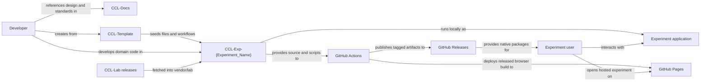

| Unit | Responsibility |
|---|---|
| Docs | Project design, developer reference, and coding standards. |
| Lab | Reusable runtime, presentation, interaction, and observation services. |
| Template | Starting files, bootstrap scripts, documentation, and inherited workflows. |
| Experiment | Independent application, domain model, exploration, and portfolio item. |
| External site | Links to or embeds a hosted experiment. |

### Reasoning

Independent experiments remain useful as standalone projects. Shared services reduce setup work and leave each experiment focused on its question. Template generation and runtime dependency retrieval are separate relationships because they have different update paths.

Source: [v0.8 sections 1 to 4](../Docs/Archive/creative-coding-lab-design-v0.8.md#1-purpose).

## 2. Repositories and source structure

**Creative Coding Lab** is the project name. Its repositories use the `CCL-` prefix.

| Repository | Purpose |
|---|---|
| `CCL-Docs` | Project documentation. |
| `CCL-Lab` | Shared runtime and reusable infrastructure. |
| `CCL-Template` | GitHub template, bootstrap tooling, and inherited experiment workflows. |
| `CCL-Exp-{Experiment_Name}` | Independent experiment application. Replace `{Experiment_Name}` with the individual experiment's name. |

```text
Creative-Coding-Lab/                    local project workspace
├── CCL-Docs/                           independent documentation repository
├── CCL-Lab/                            independent runtime repository
├── CCL-Template/                       independent GitHub template
├── Experiments/
│   ├── CCL-Exp-Orbital_Mechanics/       illustrative experiment name
│   └── CCL-Exp-Boids/                  illustrative experiment name
└── Creative-Coding-Lab.code-workspace  optional editor convenience
```

Each application uses its own fetched Lab. The parent folder groups repositories for local development. Bootstrap scripts provide dependency retrieval.

### Experiment layout

```text
CCL-Exp-{Experiment_Name}/
├── experiment.toml       version and dependency provenance
├── main.lua             application entry point
├── conf.lua             LÖVE configuration
├── experiment.lua       owned state and coordination
├── simulation.lua       mathematical/model functions
├── controls.lua         typed UI declarations
├── definitions.lua      (optional) domain-data construction
├── shaders/             (optional) experiment shader code
├── README.md            setup and running
├── EXPERIMENT.md        exploration and Case history
├── scripts/
│   └── fetch-lab.sh      fetch declared Lab release
├── vendor/
│   └── lab/             fetched dependency; Git-ignored
└── .gitignore
```

The Template distributes this starting structure. Additional folders and module boundaries can follow the experiment's needs. Its own CI/release workflows remain separate from the experiment workflows it distributes.

### Indicative Lab layout

```text
CCL-Lab/
├── lab/
│   ├── runtime.lua
│   ├── camera.lua
│   ├── input.lua
│   ├── time.lua
│   ├── drawing.lua
│   ├── ui/
│   └── debug/
├── tests/
├── README.md
└── LICENSE
```

### Reasoning

Local grouping provides a convenient workspace while each repository retains its own history. A fetched dependency makes execution independent of sibling paths. Module names describe coherent responsibilities and can evolve with working code.

Source: [v0.8 sections 4 and 5](../Docs/Archive/creative-coding-lab-design-v0.8.md#4-repository-organisation).

## 3. Technology choices

| Choice | Intended role | Decision basis |
|---|---|---|
| Lua and LÖVE | Application and runtime implementation. | Established initial platform in the source design. |
| Plain Lua tables and functions | Domain data and behaviour. | Keep state and dependencies directly readable. |
| Busted | Lua tests. | One standard test framework across shared code and optional experiment tests. |
| POSIX shell | Bootstrap and development scripts. | Share executable workflow logic between local use and CI where practical. |
| TOML | Experiment manifest. | Keep version and dependency provenance in committed metadata. |
| Markdown and Mermaid | Source documentation and relationship diagrams. | Keep technical explanations beside version-controlled files. |
| Git and GitHub | Source history, tracking, automation, releases, and Pages. | Connect reviewed changes to published source states. |
| LÖVE independent random generators | Expected initial RNG implementation behind Lab's interface. | Keep experiment calls stable as implementation details evolve. |
| VS Code | Optional local editor and multi-root workspace. | Support convenient navigation while repositories remain editor-agnostic. |

| Selection awaiting implementation | Status |
|---|---|
| UI library and detailed widget implementation | Open |
| Browser build compatibility tooling | Open |
| Linux package format | Open |
| Shader/audio API and resource details | Open |
| Run-record format and supporting tooling | Open |
| Exact dependency/tool versions | To be recorded when selected |

### Reasoning

The source establishes responsibilities and several technology choices. Detailed library evaluation belongs with implementation evidence. Recording selected versions and reasons as they emerge will make this reference useful for later maintenance and portfolio writing.

Source: [v0.8 technology](../Docs/Archive/creative-coding-lab-design-v0.8.md#3-technology-and-terminology) and [open details](../Docs/Archive/creative-coding-lab-design-v0.8.md#28-open-questions).

## 4. Runtime boundaries

This component view shows logical responsibilities inside one experiment application. Arrows name the interaction; boxes can span several implementation modules.

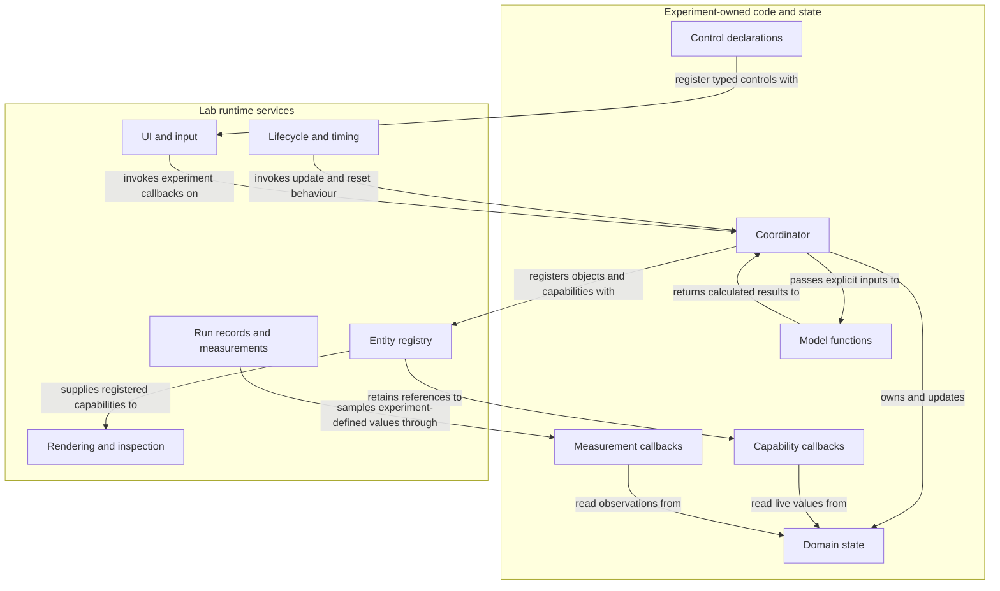

Measurements may sample system-wide state independently of entity registration.

| Lab owns | Experiment owns |
|---|---|
| Application integration and scheduling | Domain state, definitions, and collections |
| Simulation clock and speed | Meaning of a simulation update |
| Reset orchestration | Initial conditions and restoration behaviour |
| Entity registration records | Domain object lifetime |
| Geometry queries and contact tracking | Selection meaning and contact response |
| Camera, viewport, graphics/audio resources | World geometry, shaders, and sound intent |
| UI layout and generic widgets | Control declarations and parameter meaning |
| RNG service, recording, and sampling mechanisms | Experiment-specific values and observations |

### Reasoning

Ownership keeps mutations and dependencies traceable. Pure calculations fit naturally in the model layer; coordinators can apply results to owned state. Callback interfaces let shared services use live experiment values while domain decisions stay with the experiment.

Detailed writing and review rules live in [Coding Standards](../Docs/coding-standards.md#3-state-and-dependencies).

Source: [v0.8 sections 13 and 14](../Docs/Archive/creative-coding-lab-design-v0.8.md#13-responsibilities-and-data-flow).

## 5. Lifecycle and scheduling

### Established lifecycle subset

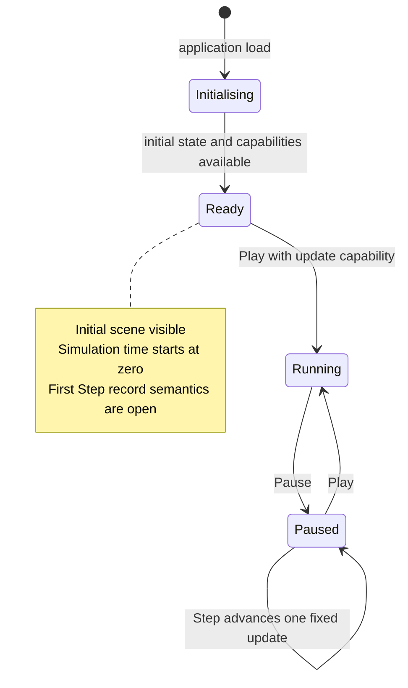

| Additional behaviour | Established intent | Open detail |
|---|---|---|
| First Play | Snapshot seed/recorded parameters, create record, lock configuration. | Preview rebuilding and exact run-boundary ordering. |
| Step from Ready | Advance one fixed update with update capability. | Run creation and configuration locking. |
| Restart | Repeat current run's initial conditions after advancement; use experiment reset capability. | Relationship to Reset/new-run action and record identity. |
| Reset mechanism | Stop advancement, call experiment restoration, zero clock, return Ready. | Accumulator/RNG and reconstruction cleanup details. |
| Completed | Optional experiment-defined completion stops advancement; application remains open. | Callback, check order, result shape, outgoing transitions. |

These rows remain outside the state diagram until their transition contracts are settled.

### Timing sequence

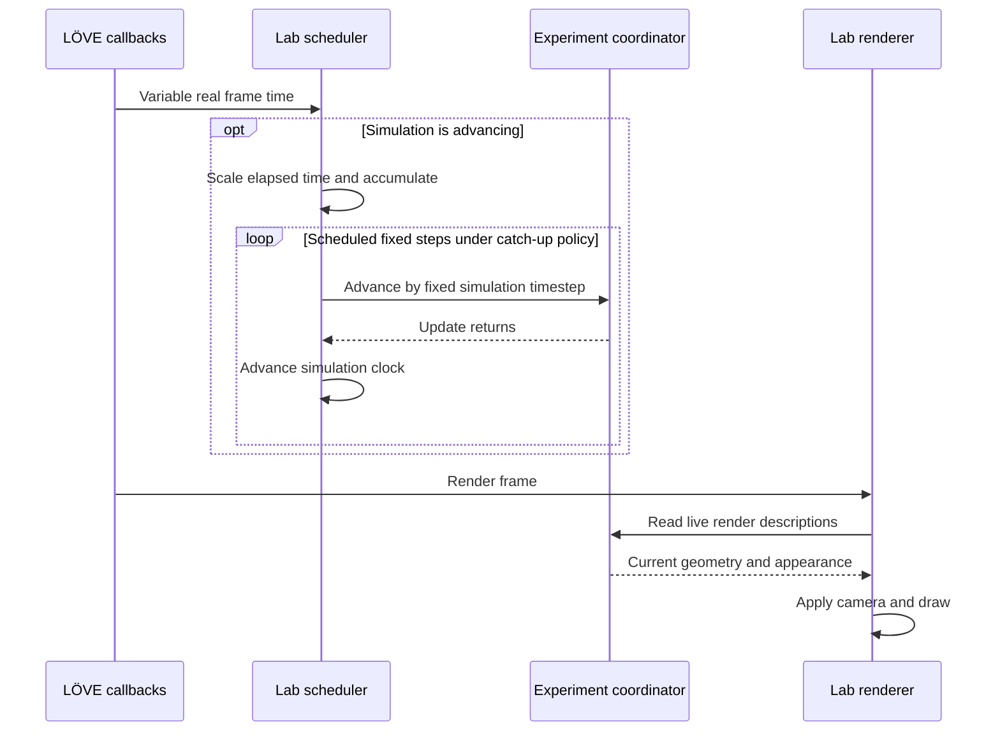

This sequence shows normal scheduling. Completion checks, measurements, contact dispatch, and failure handling require their own ordering decisions.

| Timing property | Contract |
|---|---|
| Step size | Fixed simulation timestep; default value remains open. |
| Speed | Scale the rate of accumulated simulation work. |
| Rendering | Read latest available state on render frames. |
| Pause | Keep rendering, camera, UI, and inspection available. |
| Catch-up | Apply a bounded policy selected during implementation. |

### Caught errors

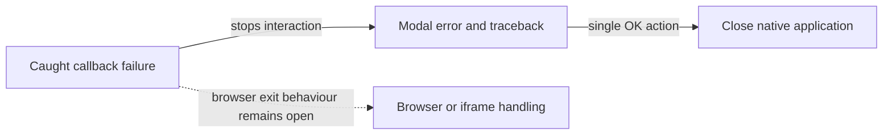

Catastrophic failures fall back to runtime/LÖVE fatal-error behaviour.

### Reasoning

Fixed steps give numerical models a predictable time increment. Separate render scheduling keeps inspection responsive during pause. Experiment-defined restoration respects the experiment's data relationships. Terminal caught-error handling ends execution at the failure boundary.

Source: [v0.8 lifecycle and timing](../Docs/Archive/creative-coding-lab-design-v0.8.md#15-application-and-run-lifecycle), [errors](../Docs/Archive/creative-coding-lab-design-v0.8.md#20-audio-and-runtime-errors).

## 6. Entities, spatial queries, and contact

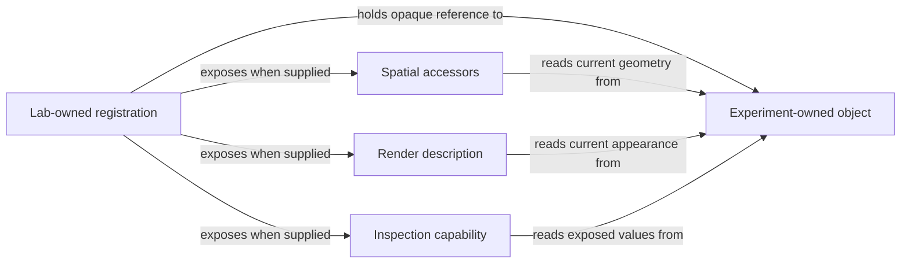

| Operation | Owner and effect |
|---|---|
| Create/store object | Experiment establishes domain lifetime. |
| Register | Lab stores the object reference and supplied capabilities. |
| Mutate | Experiment changes owned state; accessors expose current values. |
| Unregister | Lab ends registered services; object lifetime remains experiment-owned. |
| Application teardown | Registration lifetime ends with the application. |

### Query and contact contracts

| Concern | Intended behaviour |
|---|---|
| Pointer query | Transform screen coordinates to world space, query generic shapes, return objects. |
| Query results | Support multiple hits; optional convenience pick; possible object/position/distance fields. |
| Picking priority | Use meaningful geometry/order rules; 2D render order may break ties. |
| Selection | Store domain selection in experiment state. |
| Spatial geometry | Prefer generic shapes with live accessors; custom hit tests remain an escape hatch. |
| Contact | Track registered pairs and notify first overlap once per contact episode. |
| Continued/separating contact | Stay/exit callbacks may be added for experiments that need them. |
| Response | Experiment applies domain behaviour or physics. |
| Contact filtering | Contact layers have a distinct role from render order. |

```text
Pair state:    separate → first overlap → continued overlap → separation
Event:                       ENTER             STAY              EXIT
Callback:                  standard          optional          optional
```

### Reasoning

Live accessors keep one authoritative domain state. Separate spatial and visual capabilities support simple pick shapes around complex visuals. Generic overlap detection can serve many domains while each experiment supplies its own response. Geometry also provides a path toward ray queries and acceleration when real workloads justify them.

Source: [v0.8 sections 17 and 18](../Docs/Archive/creative-coding-lab-design-v0.8.md#17-entity-registration-and-lifetime).

## 7. Rendering, camera, and audio

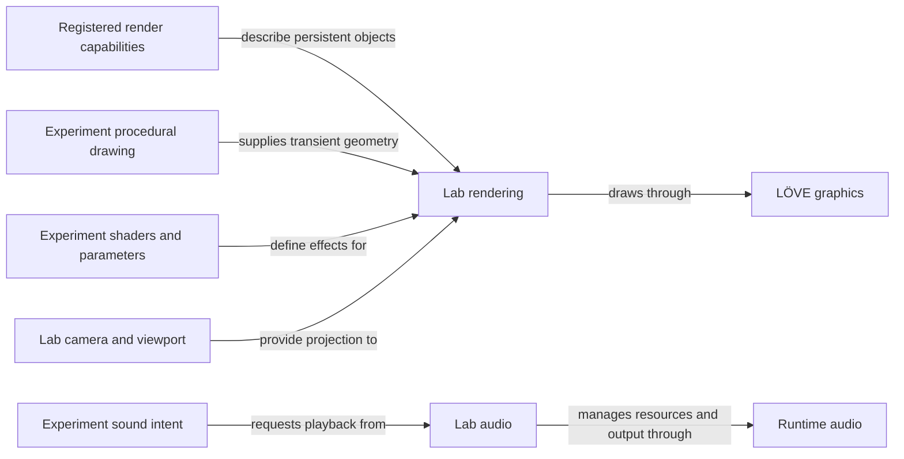

| Facility | Contract | Reasoning |
|---|---|---|
| Coordinates | Experiment geometry uses world units; Lab applies screen projection. | Keeps model calculations independent of display size. |
| Retained rendering | Read registered descriptions each render frame. | Persistent objects keep a stable registration. |
| Immediate drawing | Submit curves, fields, trails, graphs, and debug geometry for the frame. | Procedural visuals can use a direct transient path. |
| Primitive set | Initial circles, rectangles, lines, and polygons. | Supports straightforward visual experiments. |
| Camera | Initial pan/zoom defaults; experiment overrides and explicit framing requests. | Gives a useful starting view with deliberate framing control. |
| Shaders | Experiment owns code/parameters; Lab applies the pipeline and may supply standard uniforms. | Separates effect meaning from graphics-resource management. |
| Audio | Experiment chooses when/why; Lab loads, plays, mutes, and sets master volume. | Reuses presentation mechanics across experiments. |
| World audio speed | Follow simulation speed by default; individual sounds may opt out. | Keeps simulated events aligned with their presentation. |

Future 3D work should preserve experiment-facing APIs where practical. World space, separate spatial/render capabilities, and explicit camera ownership provide useful boundaries for that evolution. Detailed shaders, generated audio, pause semantics, and primitive APIs remain open.

Source: [v0.8 sections 19 and 20](../Docs/Archive/creative-coding-lab-design-v0.8.md#19-rendering-cameras-and-shaders).

## 8. Controls and input

```text
Application
├── Experiment rendering area
├── Top-left menu toggles overlay sidebar
│   ├── Instrumentation: experiment controls
│   ├── Debugging: diagnostics and inspection
│   ├── Controls: effective input bindings
│   └── Data: run history, import/export, and measurements
└── Persistent bottom bar
    ├── Left: Restart, Step, speed with numeric readout
    ├── Centre: Play/Pause
    └── Right: Mute and master volume
```

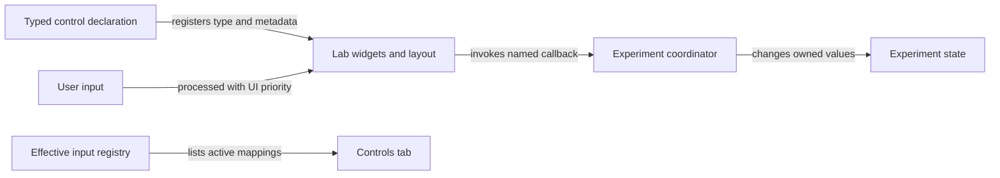

| Interface contract | Detail |
|---|---|
| Layout | Registration order, consistent spacing, per-tab scrolling; optional session scroll retention. |
| Run Configuration | Stable IDs, defaults, validation, automatic recording, locked after run start. |
| Live Controls | Runtime controls such as visual toggles. |
| Help | Optional tooltips; concise labels; visible recorded/restored indicators. |
| Randomisation | Opt-in action on suitable bounded controls, routed through normal callbacks. |
| Enablement | Capability plus lifecycle state; generally keep unavailable controls visible and disabled. |
| Input priority | UI consumes focused inputs before camera/experiment actions. |
| Defaults | Space for Play/Pause, arrows for pan, mouse wheel for zoom. |
| Overrides | Experiment registrations determine the effective binding for matching input. |
| Debugging | Timing, grids, vectors, bounds, inspection, debug drawing, and logging. |
| Data actions | History, details, Load, Import, Export, measurement CSV, and native data folder access. |

### Reasoning

Lab-owned layout keeps UI mechanics consistent across experiments. The sidebar overlay preserves the experiment viewport when opened. The Controls tab exposes effective bindings after overrides. Separating configuration from live controls identifies which values define a recorded run.

Source: [v0.8 sections 21 to 23](../Docs/Archive/creative-coding-lab-design-v0.8.md#21-application-layout).

## 9. Run records and measurements

The following logical model describes relationships. Field types, record format, and persistence schema remain open.

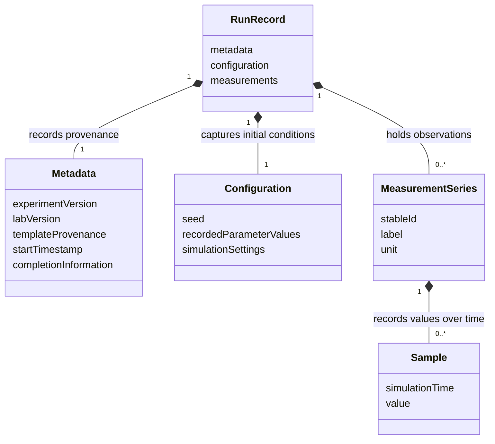

Template provenance and completion information are included where useful/provided. Measurements may describe an entity, a derived quantity, or a whole-system value.

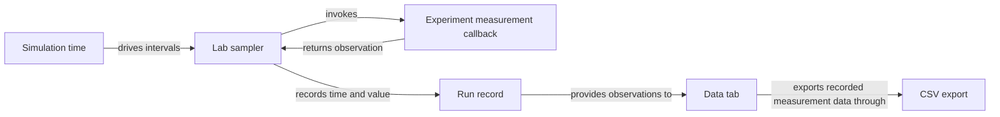

The CSV interface and selection details remain implementation choices.

| Mechanism | Contract |
|---|---|
| RNG | Lab service over the runtime generator; seed editable/rerollable before run and recorded at start. |
| Random sequence | Establish/reset the run RNG at its boundary; configuration randomisation preserves that sequence. |
| Sampling | Simulation-time intervals, Lab default with per-measurement overrides. |
| Measurement metadata | Stable ID, callback, optional label/unit. |
| Restoration | Validate record, restore seed, match parameter IDs, update recognised controls through normal callbacks, indicate unmatched values. |
| Import | Available with empty history; application to the simulation is a separate lifecycle-sensitive action. |
| Native storage | Automatic history in writable application data/save location. |
| Browser storage | Page-memory history with explicit file Import/Export for persistence. |

```text
Native logical storage
CCL/
└── experiments/
    └── <experiment>/
        └── runs/
```

### Reasoning

Stable IDs keep saved parameters independent of display labels. Callback sampling supports computed observations such as energy or average speed. Simulation-time timestamps retain meaning as execution speed changes. File export provides portability across sessions and external analysis tools.

Compatibility, exact reproduction guarantees, restart record identity, and measurement boundary timing remain open in the decision register.

Source: [v0.8 sections 24 to 26](../Docs/Archive/creative-coding-lab-design-v0.8.md#24-randomness-and-automatic-run-records).

## 10. Building an experiment

This is the intended development route. Exact setup commands and executable API examples should be added when tooling is available.

| Step | Developer task | Reference |
|---|---|---|
| 1 | Create an independent repository from Template and fetch its declared Lab version. | Sections 2 and 11 |
| 2 | Record the premise, question, setup, and things to explore. | Notebook outline below |
| 3 | Define plain domain state and model calculations. | Runtime boundaries and Coding Standards |
| 4 | Wire application initialisation and update/reset behaviour. | Section 5 |
| 5 | Register objects with the capabilities their Lab services need. | Section 6 |
| 6 | Declare typed controls and named callbacks. | Section 8 |
| 7 | Register measurements relevant to the question. | Section 9 |
| 8 | Validate the fetched environment and any experiment tests. | Section 12 |
| 9 | Record findings and publish progress or Case completion. | Sections 11 and 13 |

```text
README.md                        EXPERIMENT.md
├── Repository purpose           ├── Premise and overall question
└── Setup and running            ├── Setup and things to explore
                                 ├── Accumulated learning
                                 └── Cases
                                     ├── Number/title and objective
                                     ├── Scenario and status
                                     ├── Things to explore
                                     ├── Observations/findings
                                     └── Completion version
```

### Reasoning

The route connects code to the exploration it supports. Related scenarios can become Cases in the same experiment. A meaningfully different question can begin a separate repository, with small code reuse where helpful. Repeated shared needs are candidates for Lab promotion.

Source: [v0.8 experiment organisation](../Docs/Archive/creative-coding-lab-design-v0.8.md#4-repository-organisation) and [notebooks](../Docs/Archive/creative-coding-lab-design-v0.8.md#7-experiment-notebooks-cases-and-versions).

## 11. Dependencies and versioning

### Authority and compatibility

| Stream | Version meaning | Update rule |
|---|---|---|
| Lab | Semantic Versioning | Compatible minor/patch sync within current major; deliberate major migration. |
| Template | Independent Semantic Versioning | Compatible same-major updates; file-update/conflict mechanics remain open. |
| Experiment | Completed Cases and progress | Progress increments second component; Case completion advances whole component. |

```toml
experiment_version = "0.1"
template_version = "1.0.0"
lab_version = "1.0.0"
```

The experiment owns the seeded `experiment.toml`. Committed metadata supplies version authority; tags/releases preserve published history; GitHub variables supply configuration. Lab carries its own version metadata. The programmer chooses compatibility intent.

### Sync Lab

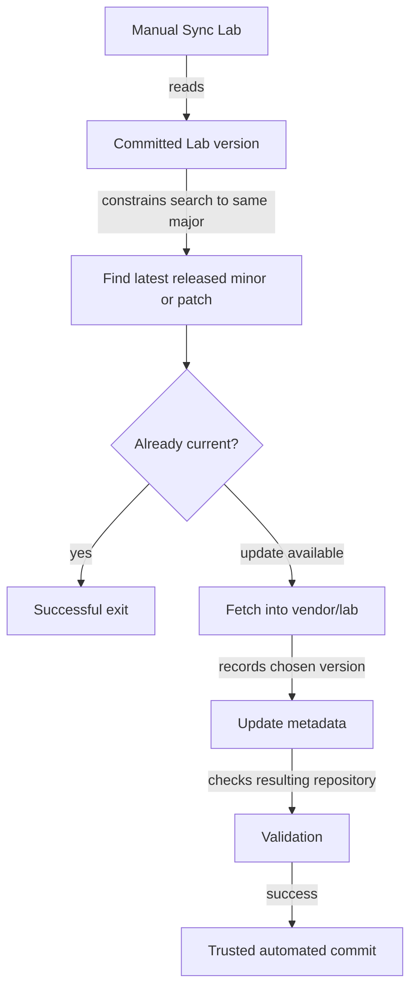

Shared POSIX scripts should support local use and GitHub workflows where practical. Lab fetching uses the declared version; Sync Lab intentionally selects a newer compatible release. Template tooling is also intended to compare recorded versions with available compatible releases.

### Case release operations

| Operation | Preconditions and effect | Example |
|---|---|---|
| Start New Case | Manual whole-version boundary check; append maintained Case template and mark active; retain version. | `1.0` remains `1.0` |
| Release Experiment | Manual progress bump, validation, commit/tag, and publication; active Case continues. | `1.2` to `1.3` |
| Complete Case | Manual notebook completion, whole-version bump, validation, and publication. | `1.4` to `2.0` |

Starting at a progress version produces a useful message directing completion of the current Case. Keep the Case template in repository content. Initial Case setup and repeated starts at an unchanged whole version remain open.

### Reasoning

Independent versions distinguish runtime compatibility, inherited tooling, and exploration progress. Exact fetched versions support repeatable builds. Explicit sync initiation gives the developer control over dependency changes. Cases retain the history of a developing question.

Source: [v0.8 sections 6 and 7](../Docs/Archive/creative-coding-lab-design-v0.8.md#6-dependencies-and-versioning).

## 12. Engineering and validation

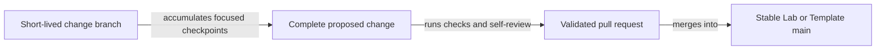

| Practice | Application |
|---|---|
| Development commits | Small checkpoints; intermediate work may be incomplete. |
| Lab/Template integration | Ordinary changes use reviewed, validated PRs. |
| Major release work | Uses an ordinary change branch. |
| Experiment work | Direct exploratory work on `main` is permitted; branches/PRs support larger changes. |
| Tracking | Issues where useful; Lab/Template may share Backlog, Ready, In Progress, Done states. |
| Experiment project tracking | Join the shared Project when substantial work benefits from it. |

### Validation responsibilities

| Repository | Checks |
|---|---|
| Lab | Busted for testable shared behaviour; syntax/configuration; structure/version metadata; release intent/docs; fixture LÖVE load/smoke path. |
| Template | Relevant Lab-style checks plus actual clean experiment bootstrap, applicable tests/build/load checks. |
| Experiment | Manifest, structure/configuration, declared dependency fetch, optional Busted tests, LÖVE/package/load behaviour. |

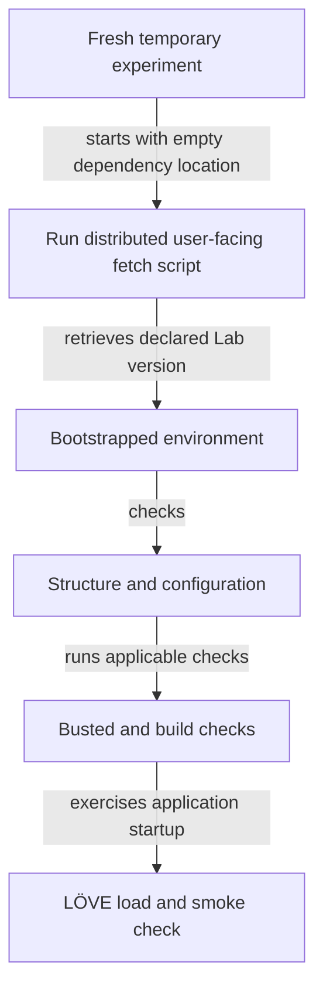

### Reasoning

The PR is the stable integration boundary. Actual bootstrap validation exercises the delivery path a developer will use. Test doubles remain useful for isolation, while optional experiment tests support exploration at its own pace.

Code-level expectations and examples are maintained in [Coding Standards](../Docs/coding-standards.md).

Source: [v0.8 sections 8 and 9](../Docs/Archive/creative-coding-lab-design-v0.8.md#8-git-tracking-and-coding-practices).

## 13. Releases and deployment

### Lab and Template PR contract

| Item | Requirement |
|---|---|
| Label | Exactly one of `release:none`, `release:patch`, `release:minor`, `release:major`. |
| Description | Summary, Release Notes, and Migration sections. |
| Patch/minor | Meaningful release notes. |
| Major | Meaningful migration guidance. |
| Validation | Check release intent/documentation alongside code/configuration checks. |

`release:none` explicitly records the choice to keep the published version unchanged. Release intent belongs to the PR.

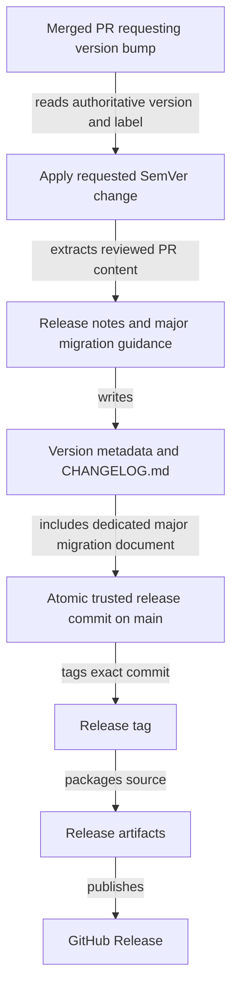

The same workflow supports manual recovery, with idempotence where practical. Trusted release/sync automation may commit directly to protected `main`.

### Workflow ownership

| Repository | Workflow entry points |
|---|---|
| Lab | PR Validation; Release after a release-requesting merged PR; manual Release recovery. |
| Template | PR Validation with clean bootstrap; Release and recovery; manual Sync Lab. |
| Experiment | Validation; manual Sync Lab; Start New Case; Release Experiment; Complete Case. |

### Experiment deployment

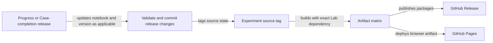

| Output | Intended contract |
|---|---|
| Provenance | Record exact Experiment, Template, and Lab versions. |
| Artifact matrix | Browser, Windows x64, macOS, Linux where practical; optional `.love`. |
| Package contents | Include the required Lab in `vendor/lab`. |
| Source identity | Tag, packages, and deployed browser build correspond to one exact state. |
| Pages | Latest released experiment. |
| Browser presentation | Responsive sizing, fullscreen where practical, direct use and iframe embedding where supported. |
| Lab/Template artifacts | Serve their fetch/update mechanisms. |

### Reasoning

Reviewed PR content supplies release documentation. A dedicated release commit ties version metadata to the tagged package source. The experiment artifact matrix gives several ways to run the same release, with provenance available for diagnosis and reproduction.

Source: [v0.8 sections 10 to 12](../Docs/Archive/creative-coding-lab-design-v0.8.md#10-pull-requests-and-release-automation).

## 14. Implementation sequence and decision register

### Existing delivery order

| Order | Work |
|---|---|
| 1 to 4 | Lab repository/version metadata; minimal runtime; fixed timing and controls; 2D camera/transforms. |
| 5 to 8 | Sidebar/typed controls; seeded run records; optional completion and measurements; inspection/CSV. |
| 9 to 12 | Entity registry; spatial/contact/rendering; audio; Template, manifest, scripts, and workflows. |
| 13 to 16 | Representative experiment; observe friction; promote proven shared code with tests/docs; repeat with another experiment. |

### Decisions to settle

| ID | Topic | Decision still needed |
|---|---|---|
| D1 | Run boundaries | First Step recording/locking; configuration preview rebuild; Restart/Reset/new-run relationship. |
| D2 | Completion | Callback/result shape, check ordering, and controls/transitions after Completed. |
| D3 | Reconstruction | RNG/clock/accumulator handling, registration/contact cleanup, and sample treatment. |
| D4 | Record identity | Restart/load identity, finalisation, compatibility, retention, and format. |
| D5 | Measurements | Initial/final samples, fixed-step alignment, timestamps, value types, and default intervals. |
| D6 | Reproducibility | Guarantees across versions/platforms and state-changing live interaction. |
| D7 | Error exit | Browser/iframe behaviour and treatment of available run data. |
| D8 | Updates and Cases | Template update conflicts/explicit version selection; initial/repeated Case starts; progress-number details. |
| D9 | API contracts | Module names, lifecycle signatures, direct LÖVE access, capability/primitive/control metadata, and camera API. |
| D10 | Runtime details | Input modifiers/hold; contact dispatch; timing defaults/backlog; shader/audio APIs; generated audio and pause semantics. |
| D11 | Delivery details | Browser tooling, Linux format, supporting version/script names, and diagnostic rollout. |

### Evolution driven by evidence

| Capability | Trigger or direction |
|---|---|
| Built-in charts | Real measurement workflows establish plotting needs; CSV serves initial analysis. |
| Discrete observations | Experiments demonstrate useful event/result records. |
| 3D and ray queries | A concrete 3D experiment shapes rendering, camera, and query changes. |
| Shared physics/effects/acceleration | Repeated use demonstrates a generic facility. |
| Render interpolation | Visible needs in real experiments justify it. |
| Public catalogue | Optional links, media, descriptions, and collection bootstrap scripts; projects retain independence. |

### Reasoning

The decision register keeps uncertainty visible during implementation. Working examples provide evidence for API choices and shared abstractions. Future additions can then be justified by observed needs and traced to the source decision they refine.

Source: [v0.8 sections 27 to 29](../Docs/Archive/creative-coding-lab-design-v0.8.md#27-initial-development-sequence).
